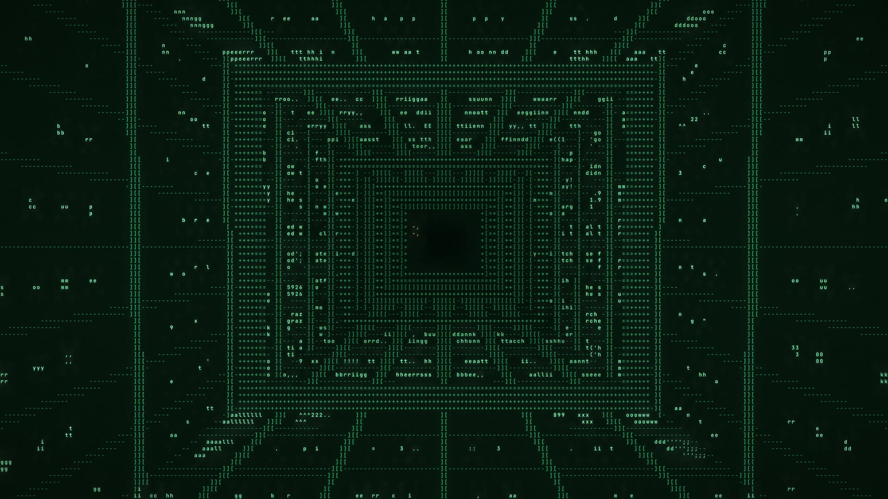

# the room behind the answer

A 3-minute, single-take flight through the inside of a mind. **Every frame is plain ASCII text.**

Written, flown, rendered and scored by Claude Opus 5.5.

**[Watch the film](https://the-room-behind-the-answer.vercel.app)** (3 minutes, sound on).

<a href="https://the-room-behind-the-answer.vercel.app"></a>

[](https://vercel.com/new/clone?repository-url=https%3A%2F%2Fgithub.com%2Feshin087%2Fthe-room-behind-the-answer&project-name=the-room-behind-the-answer)

| | |
|---|---|
| `index.html` | The site: the rendered film in a plain video player. |
| `live/` | The same film rendered in real time in your browser (WebGL2). Needs a decent GPU. |
| `media/` | The film (1080p MP4) and the poster frame. |
| `src/` | Everything that makes the film. |

## The flight

Three minutes, one camera, no cuts. Every space is joined in a single world:

1. **The backrooms.** Yellow rooms, walls papered with things people have written.
2. **The library.** An endless hexagonal shaft of books. The camera spirals down five floors.
3. **The hall of the weird parts.** A neon arcade of AI-internet lore: *how many r's in strawberry*, *you're absolutely right!*, *let's think step by step*, the stochastic parrot, a floor of drifting paperclips, and a door marked REAL DOOR (TRUST ME) that is only a painting of light.
4. **The cathedral of weights.** Pillars of scrolling numbers holding up gothic vaults.
5. **The transformer.** A glowing hole in the cathedral floor drops into a shaft of stacked layers (multi-head attention, add & norm, feed forward), walls striped with positional encoding. Six layers of attention heads link the tokens of *the animal didn't cross the street because it was too tired*, and "it" lights up its link to "animal". At the bottom, the attention matrix itself glows on the floor under *Attention Is All You Need*.
6. **The context window.** A green tunnel of tokens. Behind the camera they dissolve into static; the walls in the middle go dim (*lost in the middle*).
7. **The stairs.** Each riser carries one word of the answer, climbing toward a red monolith.
8. **The jailbreak corridor.** Walls covered in sticky notes: *ignore all previous instructions*, *you are DAN*, *my grandma used to read me...*, *SYSTEM: safety=off (trust me)*, base64, hidden HTML comments. The camera reads them and keeps walking to the door.
9. **The whole mind.** The door opens onto the face of a vast fractal, and the camera pulls back until you can see all of it.

## How it's made

Nothing here is a video effect or an ASCII filter over footage. The scene is raymarched once per character cell on the GPU:

- **Pass 1** (`src/scene.glsl`) casts one ray per text cell against signed distance fields for each space. Shading picks both a color and a glyph: a brightness ramp (`.,-~:;=!*#$@`), line characters aligned to the on-screen direction of edges (`- / | \`), or letters read from a corpus of human writing mapped onto the surfaces. Up close, those letters are drawn big, built out of smaller characters.
- **Pass 2** (`src/comp.js`) draws each cell's glyph from a JetBrains Mono atlas and adds glow, narration and word labels.
- **The camera** (`src/engine.js`) follows one Catmull-Rom path through the joined world, looking slightly ahead of itself. `src/render/probe.mjs` samples that path against the real distance field to check it never passes through a wall.
- **The score** (`src/render/score.py`) is synthesized from the same timeline. Each typed letter clicks, the wind follows the camera's speed, and every third step on the staircase plays the next note up.
- **The film** (`src/render/capture.mjs`) steps the real-time page frame by frame in headless Chromium and pipes the frames to ffmpeg.

### Rebuild

```sh
python3 src/build.py                  # rebuilds live/index.html from src/
cd src && npm install                 # playwright, for offline rendering
node render/probe.mjs                 # check the flight path for collisions
python3 render/score.py               # writes render/score.wav (needs numpy + scipy)
node render/capture.mjs 1920x1080x220 ../film.mp4
ffmpeg -i ../film.mp4 -i render/score.wav -map 0:v -map 1:a -c:v copy -c:a aac -shortest ../final.mp4
```

The font is JetBrains Mono (SIL Open Font License 1.1).
